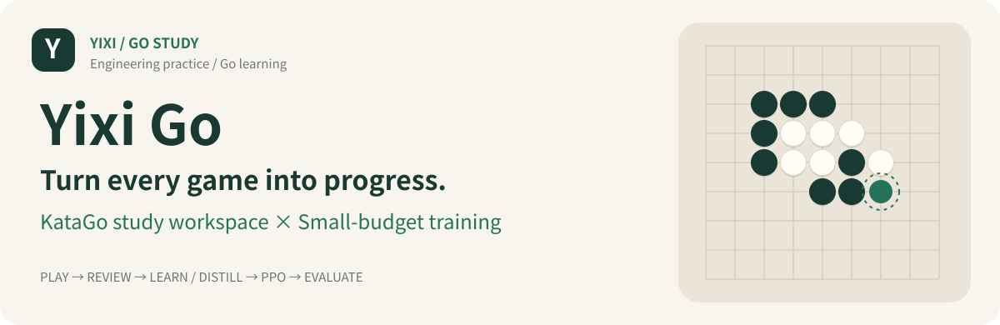
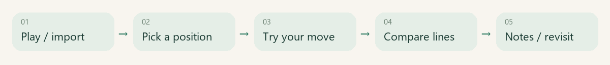
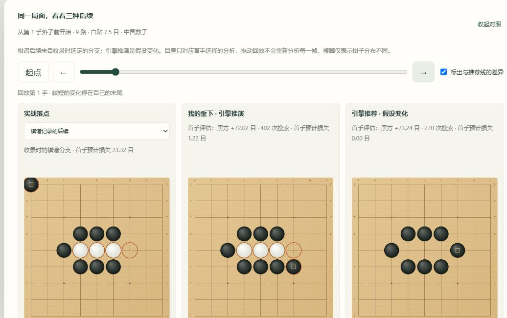
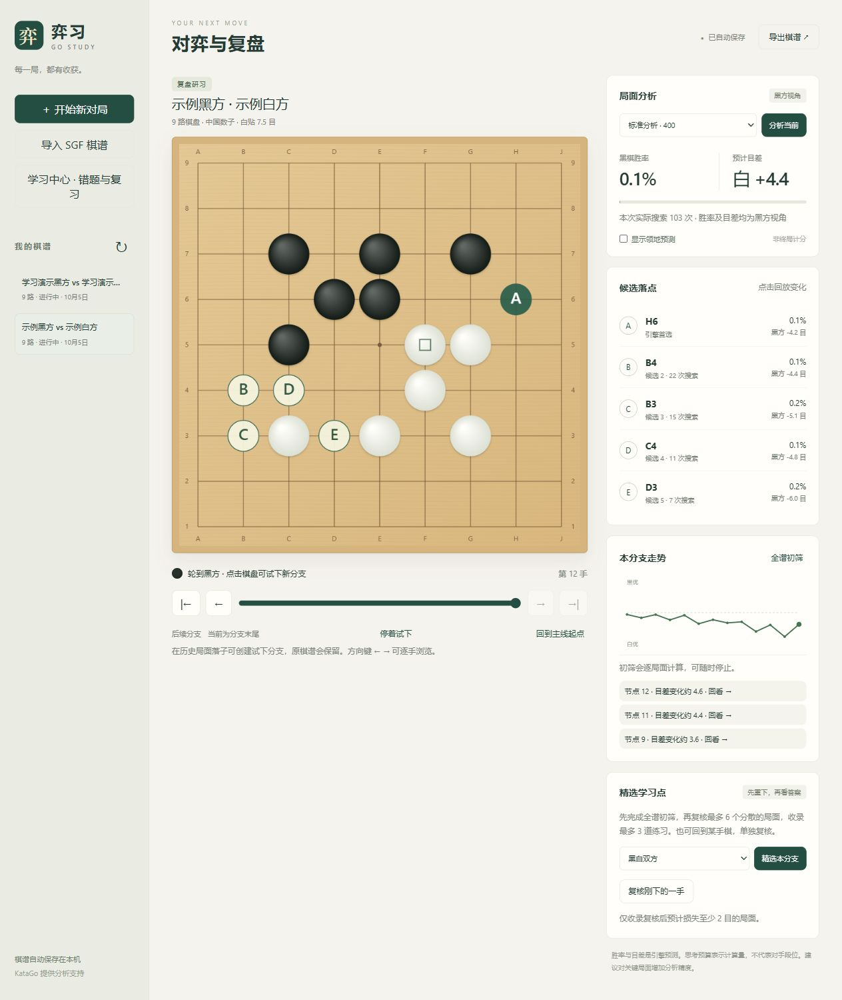
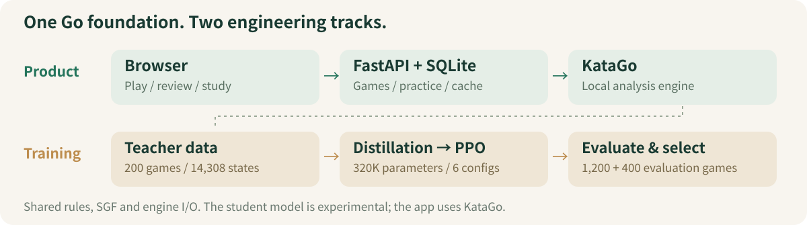
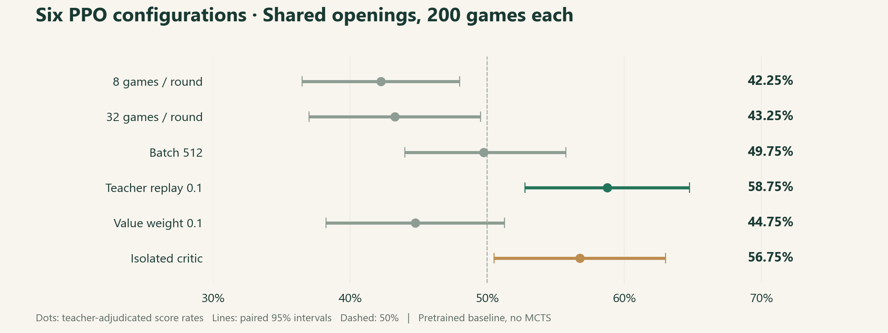

<p align="center">
  <a href="README.md" title="Current language"></a>
  <a href="README.zh-CN.md"></a>
</p>

<p align="center">
  
</p>

<p align="center">
  <a href="https://xiaofei1412.github.io/yixi-go/">Project website</a> ·
  <a href="https://github.com/xiaofei1412/yixi-go/releases/latest">Windows download</a> ·
  <a href="README-product.md">Product guide</a> ·
  <a href="README-train.md">Training experiments</a> ·
  <a href="docs/TECHNICAL.md">Technical documentation</a> ·
  <a href="docs/PROJECT.md">Project overview</a>
</p>

**A practical Go study app. A model training project with results you can inspect.**

The app uses KataGo for game review and practice; the training track explores distillation, PPO, and controlled evaluation with a small student network.

<sub>The app UI and detailed guides are currently in Simplified Chinese. This overview and the project website are available in both languages.</sub>

| 9 / 13 / 19 boards | 14,308 positions | 6 PPO configurations | 1,600 evaluation games |
| :---: | :---: | :---: | :---: |
| Play and variation review | From 200 teacher games | 3 rounds each, diagnosed step by step | 1,200 comparison + 400 confirmation |

## 01 · Turn game review into practice





<sub>Actual Chinese UI · separate demo database · constructed SGF. Left: recorded continuation; middle/right: engine projections. Orange circles mark board differences.</sub>

| Capability | What the player gets |
| --- | --- |
| **Play / variation review** | Autosave, SGF import/export, candidate moves and score trends; explore branches while preserving the game record |
| **Select / retry** | Verify a move from your game, think before revealing the reference, and accept alternative moves with comparable estimated outcomes |
| **Three-way comparison** | Replay the recorded line, your choice, and the recommendation together; inspect captures and board differences |
| **Study center** | Notes, 8 manual topic labels, 7/30-day statistics, and reviews scheduled at 1/3/7-day intervals |

<details>
<summary>View the full play and review interface</summary>



</details>

## 02 · From teacher distillation to diagnosable PPO



**320K parameters · 11 input planes · policy / value / score / ownership outputs**

| Pretraining | Post-training | Experiment engineering |
| --- | --- | --- |
| Multitask distillation, D4 augmentation, mixed precision | PPO clipping + KL to a frozen reference | Source hashes, checkpoint recovery, per-round logs |
| Teacher top-move agreement **2.91% → 27.37%** | Teacher-supervised replay / value-gradient isolation | Shared openings, swapped colors, intervals, fresh-opening confirmation |



**Retained: the PPO candidate with teacher replay weight 0.1, alongside the pretrained baseline.** It scored **56.25%** in a fresh 200-game batch, with a 95% interval of **49.75%–62.75%**; an earlier batch scored **48.25%**. Negative results are preserved.

<sub>Scores are teacher-adjudicated against the pretrained reference, without MCTS—not official win rates or ranks. Each configuration has one training seed; about 8.9% of validation rows share early positions with training. This is a budget-bounded stopping decision; stable superiority and mathematical convergence have not been established. The student model does not power the product.</sub>

## 03 · Engineering decisions worth discussing

| Problem | Implementation |
| --- | --- |
| Sampling saved only Black's positions | Save every move and check color coverage during collection, resumption, and loading of both data partitions |
| More rollout games also meant more updates | Control update counts through batch size, then test replay and value gradients separately |
| Edited records / repeated submissions affected practice | Independent snapshots, idempotent submissions, and caches tied to engine identity |
| Copied Python environments failed on another PC | Probe the interpreter, preserve invalid environments, and rebuild locally; also ship a standalone Windows bundle |

`FastAPI` · `SQLite` · `JavaScript / Canvas` · `KataGo` · `PyTorch` · `Preserved C++ MCTS`

Historical validation: **73 product/launcher Python tests · 21 frontend checks · 30 training tests**, plus real-engine integration and training audits. Desktop checks cover selected app flows; the website also has a narrow-screen layout check. Full browser compatibility and mobile touch validation of the app remain open. The app runs locally for a single user.

## Get started

**Standalone build:** [download the Windows x64 ZIP](https://github.com/xiaofei1412/yixi-go/releases/download/v1.0.0/YixiGo-v1.0.0-windows-x64.zip), extract the entire folder, then double-click `YixiGo.exe`. Your browser opens automatically.

Python, KataGo, and the model are included. Requires Windows 10/11 x64 and a compatible OpenCL GPU driver. First launch creates an empty database under the current account's `%LOCALAPPDATA%\YixiGo`; there is no cloud sync. The first analysis may need GPU tuning. See the [desktop guide (Chinese)](docs/WINDOWS.md).

<details>
<summary>Run from source / contribute</summary>

1. Install **Python 3.10+** on Windows, then prepare KataGo, its model, and a compatible driver using the [engine setup guide (Chinese)](katago_engine/INSTALL.md).
2. Run the launcher below from the project folder, allow initial dependency installation, and keep its window open.
3. Open http://127.0.0.1:8000 and import the [review demo](examples/review-demo.sgf) or [study demo](examples/study-demo.sgf).

```powershell
.\start-product.cmd
```

The product does not require PyTorch. Training setup and reproduction commands are in the [training guide (Chinese)](README-train.md). The source repository excludes user data, virtual environments, and model binaries.

</details>

---

[Product and rules (Chinese)](README-product.md) · [Training and result limits (Chinese)](README-train.md) · [Technical documentation (Chinese)](docs/TECHNICAL.md) · [Project overview (Chinese)](docs/PROJECT.md)
