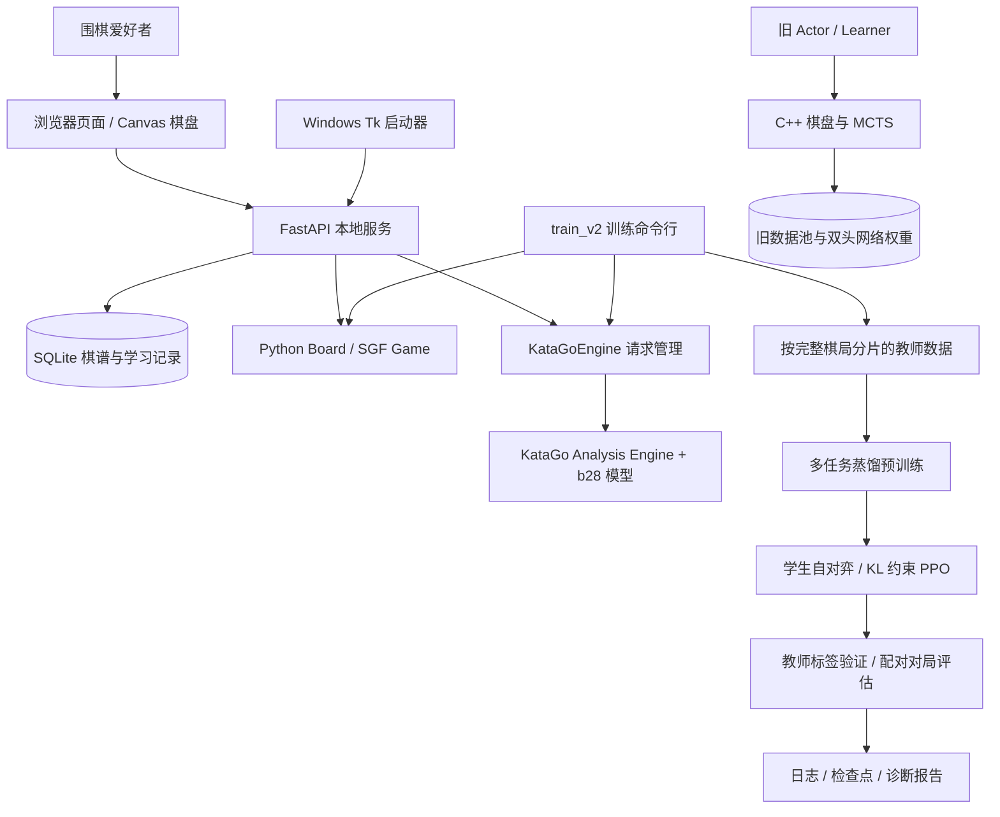

# 弈习围棋 AI 系统技术文档

> 整理日期：2026-10-29。依据当前源码（整理前提交 `b00feb3`）、分路线 README 和已归档实验结果编写。
> 本文用于理解设计、阅读代码和后续维护。训练数值与验收数量均为历史记录，本轮没有重新训练、启动真实引擎或执行全量业务回归。

[项目首页](../README.md) · [产品操作与开发记录](../README-product.md) · [训练过程与复现记录](../README-train.md) · [Windows 版说明](WINDOWS.md)

## 阅读导航

| 想了解什么 | 从哪里开始 |
| --- | --- |
| 项目做了什么、两条路线是什么关系 | [1. 项目范围与成果](#1-项目范围与成果)、[2. 总体架构](#2-总体架构) |
| 产品代码如何组织 | [3. 模块与代码入口](#3-模块与代码入口)、[4. 规则与棋谱模型](#4-规则与棋谱模型) |
| 数据库、API、并发和缓存如何工作 | [5. 服务与持久化](#5-服务与持久化)、[6. 引擎通信与缓存](#6-引擎通信与缓存) |
| 怎样把复盘变成练习 | [7. 学习流程与一致性设计](#7-学习流程与一致性设计) |
| 模型如何训练、优化是否有效 | [8. 新旧训练系统](#8-新旧训练系统)、[9. 训练方法](#9-训练方法)、[10. 实验与模型选择](#10-实验与模型选择) |
| 怎样运行、恢复训练、定位问题 | [11. 运行与诊断](#11-运行与诊断)、[12. 打包与发布](#12-打包与发布)、[13. 验证与排错](#13-验证与排错) |
| 哪些结论可以讲、以后还可以做什么 | [14. 技术取舍与后续方向](#14-技术取舍与后续方向) |

## 1. 项目范围与成果

项目围绕两个目标展开：为围棋爱好者提供本地复盘与练习工具；在有限算力下实践围棋模型从数据生成、监督预训练到强化学习后训练的完整过程。

| 路线 | 核心目标 | 当前成果 |
| --- | --- | --- |
| KataGo 产品 | 把强引擎的分析结果组织成学习流程 | 9/13/19 路对弈、SGF 分支复盘、精选学习点、独立重下、三栏变化对照、学习统计与固定间隔复习 |
| 自训练模型 | 实践训练工程、诊断与对照评估 | 200 局教师棋谱、14,308 状态、约 32 万参数模型、10 epoch 预训练、六组 PPO 对照与最终 1,600 局比较及复核 |
| 软件交付 | 让普通使用者能在本机运行 | Windows x64 免安装版 v1.0.0、空库初始化、Windows 账户数据目录、GitHub Release 与静态展示页 |

产品分析使用官方 KataGo 引擎及其 b28 模型。自行训练的学生模型用于实验，尚未替换产品分析引擎。两条路线共享 Python 围棋规则与本地引擎通信模块，具有各自的数据和输出目录。

这里的“预训练”指围棋领域的多任务监督蒸馏；“后训练”指学生自对弈、教师末局估值奖励下的 PPO。项目没有实现语言模型预训练、RLHF、学习型奖励模型或完整的 AlphaZero 训练系统。

开发顺序为：保留原始 C++ MCTS 自对弈原型 → 完成产品四阶段 → 修复源码启动迁移 → 建立独立训练系统并逐项实验 → 整理结果 → 发布 EXE → 完善 GitHub 展示。

## 2. 总体架构



产品前端与 API 同源。所谓 KataGo API，是本地子进程的 Analysis Engine JSON 行协议；FastAPI 在其外层提供面向页面的 HTTP 接口。GitHub Pages 只展示截图、结果和下载入口，不运行 FastAPI、KataGo 或训练任务。

桌面 EXE 内置 Python 服务，由 Tk 控制窗口打开默认浏览器。界面仍是浏览器页面，并没有将棋盘重新实现为原生 Windows 控件。

## 3. 模块与代码入口

| 模块 | 文件 | 主要职责 |
| --- | --- | --- |
| 页面 | [index.html](../index.html)、[app.js](../app.js)、[style.css](../style.css) | Canvas 棋盘、导航、候选变化、学习窗口、响应式布局 |
| 服务 | [server.py](../server.py) | FastAPI 路由、请求校验、业务事务、SQLite 持久化 |
| 规则与 SGF | [go_game.py](../go_game.py) | `Board` 合法性与计分；`Game` 棋谱树、位置恢复和导入导出 |
| 引擎适配 | [katago_service.py](../katago_service.py) | 子进程生命周期、请求关联、并发槽位、超时与退出处理 |
| 学习统计 | [study_stats.py](../study_stats.py) | 作答记录、北京时间归日、知识点汇总 |
| 变化对照 | [study_compare.py](../study_compare.py) | 棋谱后续提取、PV 合法回放、提子与终止原因 |
| 桌面与路径 | [desktop_launcher.py](../desktop_launcher.py)、[product_paths.py](../product_paths.py) | 单实例启动、资源/数据分离、浏览器打开与退出 |
| 新训练 | [train_v2.py](../train_v2.py)、[train_v2_common.py](../train_v2_common.py) | CLI、采样、训练、评估；网络、特征、损失、日志和数据协议 |
| 旧训练 | [worker_selfplay.py](../worker_selfplay.py)、[worker_train.py](../worker_train.py)、[resnet_model.py](../resnet_model.py) | 原始 Actor/Learner、文件经验池、双头网络 |
| 旧搜索扩展 | [cpp_src/fast_mcts.cpp](../cpp_src/fast_mcts.cpp)、[setup.py](../setup.py) | C++ 棋盘、MCTS、pybind11 绑定与 MSVC 构建 |
| 交付 | [scripts/build-windows.py](../scripts/build-windows.py) | 明确文件清单打包、许可收集、manifest 和 ZIP 校验值 |

建议阅读代码时沿一条具体流程前进：`app.js → server.create_game/mutation/analyze → Game.position/query → KataGoEngine.query`。理解普通棋局后，再读 `study_create → study_start → study_answer → study_comparison`。训练代码则先读 `features/StudyNet/teacher_targets`，再读 `collect/pretrain/posttrain/evaluate`。

## 4. 规则与棋谱模型

### 4.1 棋盘和动作编码

`Board.cells` 是长度为 `size²` 的一维数组：黑棋为 `1`，白棋为 `-1`，空点为 `0`。动作 `0…size²−1` 对应棋盘交叉点，`size²` 表示停着。因此 9 路有 82 个动作，19 路有 362 个动作。

界面坐标与引擎坐标通过 `coordinate()`、`action_from_coordinate()` 转换，列名跳过 I。`Board.play()` 先在副本上尝试落子、提子及合法性检查，确认后才提交状态；非法落子不会留下半完成的棋盘修改。

### 4.2 规则范围

新对局默认中国数子规则：全局同形禁着、禁止自杀、无额外让子补偿。双停进入待结算状态，用户标记死子后，通过确定性的数子算法计算结果；领地预测不能替代死活确认。

SGF 可导入 Chinese、Japanese、Korean 规则。中国规则使用全局同形检查，日/韩规则使用单劫回放及相应引擎规则；本地终局计分仅实现中国数子。未声明规则时默认中国规则；默认贴目为中国 7.5、日/韩 6.5。

### 4.3 棋谱树与持久化快照

`Game` 使用 sgfmill 保存完整树，节点路径如 `root/0/1`。`cursor` 指当前节点；历史试下产生分支，已有后续保留。`snapshot()` 为前端生成棋盘、合法动作、游标、子节点、选定路线和 revision；`dump()` 保存完整 SGF 字符串及模式、状态、版本等业务字段。

SGF 导出先复制棋局，再将选定分支移到导出主线，避免改变原有节点路径。导入会验证所有分支，支持根节点摆子和批注；拒绝中途摆子/换色、多盘合集和不支持的规则。当前上限为单文件 2 MB、3,000 个节点、9/13/19 路棋盘。

## 5. 服务与持久化

### 5.1 SQLite 六张表

数据库由 `database()` 通过 `CREATE TABLE IF NOT EXISTS` 初始化，主要复杂对象存为 JSON。

| 表 | 关键字段 | 作用 |
| --- | --- | --- |
| `games` | `id, data, updated` | 完整棋谱与当前交互状态 |
| `analysis` | `game_id, node, hash, data` | 局面分析缓存；主键为棋局与节点 |
| `study_points` | `id, data, note, streak, due` | 不可变题目快照，以及可修改的笔记/复习状态 |
| `study_attempts` | `id, point_id, result, created` | 一次独立作答会话；结果 JSON 包含完成信息 |
| `study_tags` | `point_id, tag` | 题目与人工知识点标签的多对多关系 |
| `study_comparisons` | `attempt_id, data` | 已完成作答的三栏对照缓存 |

当前没有显式数据库外键或独立版本迁移框架。新增阶段通过增表及兼容旧 JSON 字段完成演进；日后若改变已有表或字段语义，需要先制定迁移与回滚方案。

### 5.2 API 分组

| 业务 | 代表接口 |
| --- | --- |
| 棋局管理 | `POST/GET /api/games`；`GET /api/games/{id}` |
| SGF | `POST /api/import`；`GET /api/games/{id}/sgf` |
| 对局与导航 | `POST /api/games/{id}/move`、`ai`、`navigate`、`review`、`undo` |
| 结算与恢复 | `POST /api/games/{id}/resign`、`score`、`resume` |
| 分析与回放 | `POST /api/games/{id}/analysis`、`preview`；`GET .../analyses` |
| 精选学习点 | `POST /api/games/{id}/study-shortlist`、`study-points` |
| 练习作答 | `GET /api/study`；`POST /api/study/{point_id}/start`；`POST /api/study-attempts/{attempt_id}/answer` |
| 学习记录 | `POST /api/study/{point_id}/note`、`tags`；`GET .../learning`、`GET /api/study/stats` |
| 变化对照 | `POST /api/study-attempts/{attempt_id}/comparison` |

接口的完整字段以 `server.py` 中的 Pydantic 请求模型及当前服务 `/docs` 为准。例如创建棋局后，落子请求携带 `{"action": 0, "revision": 0}`；不能只发送动作而忽略版本。

### 5.3 乐观版本校验和进程内锁

`mutation()` 在 `RLock` 保护下执行“读棋局 → 核对 revision → 修改 → revision 加一 → 保存”。版本过旧时返回 HTTP 409，由前端同步服务端状态。

耗时搜索通常放在锁外执行，写回前再次确认局面或版本仍适用。这样可减少引擎等待对普通读写的阻塞，又避免将旧搜索结果作为新棋局的落子。

当前设计面向本地单服务进程。`RLock` 只能协调一个进程内的线程，不是跨进程事务协调器；不应直接增加多个 Uvicorn worker 来横向扩展。API 没有应用内账号认证，默认使用 `127.0.0.1`。

## 6. 引擎通信与缓存

### 6.1 一次请求的生命周期

1. `Game.query()` 将规则、贴目、根节点摆子及落子历史转换为引擎输入，而非仅提交最终棋子分布。
2. `KataGoEngine` 首次需要时启动一个本地 Analysis Engine 子进程。
3. 请求附带唯一 ID，通过 stdin 写一行 JSON。
4. 后台读取线程解析 stdout，以 ID 找到对应 Future，忽略中间报告和警告，交付最终结果或错误。
5. 引擎退出时，使仍在等待的请求明确失败；关闭服务时停止子进程。

客户端最多有 4 个请求槽位，获取槽位最多等待 5 秒；默认响应等待 90 秒。超时后发送 terminate 请求终止对应分析。引擎配置中的 `maxTime=25` 是搜索时间限制，不包含全部加载与首次 GPU 调优耗时。

### 6.2 复用较深分析

分析缓存身份由查询语义和引擎标识生成：查询排除 `maxVisits` 后，与引擎标识一起计算 SHA-256。在相同 `game_id`、`node` 和查询哈希下，较高 visits 的缓存可满足较低预算请求；迟到的浅搜索不会覆盖已有深搜索。当前没有跨棋谱或不同节点的全局局面缓存。

需要区分两种身份校验：产品引擎标识来自文件名、大小和修改时间；训练协议对教师文件使用内容 SHA-256。产品缓存键虽使用哈希，但不等于其内部每个引擎文件都做了内容哈希。

修改引擎、模型或配置后需要重启服务，使内存中的标识刷新。旧学习题仍保存，但模型身份不匹配时停止进入有效复习队列，避免混用不同教师的答案。

### 6.3 前端批处理

全谱初筛按当前分支串行请求，每局面预算 100 visits；精选也串行复核。点击停止会阻止继续发出后续请求，已经发出的单次搜索仍可能完成并保存。前端 localStorage 主要记录活动棋局 ID，棋谱与练习记录的持久化来源是 SQLite。

## 7. 学习流程与一致性设计

### 7.1 从分析线索到可靠程度有限的练习

初筛按落子方视角寻找预计损失至少 2 目的节点，最多保留 6 个，节点之间至少间隔 3 个。随后每次精选最多新增 3 道题，避免把连续的小波动全部收录。

正式收录在落子前的同一局面进行两次搜索：一次取得推荐候选，一次只允许根节点选择实战落点。两次预算均为 400，候选实际 visits 均须至少 100，且关闭根节点宽噪声。

令 `p=1` 表示本手落子方为黑，`p=-1` 表示白，`s_best` 与 `s_move` 都为黑方视角的候选目差，则：

```text
预计损失 = max(0, p × (s_best − s_move))
```

损失达到 2 目才收录；练习作答时不超过 1 目视为通过。作答为推荐点或原实战点时复用题目中的分析，其他落点做受限根搜索。因此可接受效果接近的不同下法，而非只比较是否与首选坐标相同。

这些是有限搜索下的学习启发式。搜索门槛并不证明答案唯一、死活已被证明或预计损失没有误差；关键局面可以回主复盘增加预算。

### 7.2 不可变快照与幂等作答

收录时冻结棋谱、选定分支、共同起点和参考分析，使原棋谱后续试下不会改变旧题。题目身份用于去重，重复精选保留已有笔记与复习状态。

开始练习会创建 attempt，并令本题旧未完成会话失效。作答前仅返回必要的棋盘与合法动作，隐藏参考落点、批注、笔记和分析值，防止答案提前泄露。

作答接口在搜索前检查结果是否已存在，在搜索结束后的写入事务中再次检查。同一个 attempt 重试返回原结果，不重复增加完成次数；非法落子、引擎失败或搜索不足不计完成，允许重试。

### 7.3 复习和统计

| 情况 | 处理 |
| --- | --- |
| 新收录 | 立即待复习 |
| 到期答对 | 按连续通过次数安排 1、3、7 天；之后保持 7 天 |
| 未通过或直接看答案 | 连续通过次数归零，10 分钟后再复习 |
| 提前答对 | 不增加连续通过次数，不延后原计划 |
| 提前失败或看答案 | 按 10 分钟规则重新安排 |

知识点标签由用户手动选择，8 类中最多选 3 类；笔记最多 1,000 字。时间保存为 UTC，学习概览按北京时间自然日归档。通过率的分母只包含实际提交落子的作答，直接看答案只计完成、不计通过。

知识点回顾每题取时间范围内最近一次结果，至少 3 道不同题目才标记为样本足够。反复练一道题不会增加不同题目数，多标签类别数量也不能直接相加当作独立总数。统计与笔记整理无需启动引擎。

### 7.4 三栏变化对照

三栏分别呈现实战落点、自己的重下和推荐点的后续。实战栏可在“棋谱记录后续”与“该落点的引擎推演”之间切换；前者是快照中保存的分支，后者是假设双方继续按引擎行棋。

每条线最多 12 手，按规则逐手重放并累计提子；遇非法后续、双停或长度上限停止并说明。短变化停在自身末尾，不补造落子。橙色差异仅表示当前棋子分布差异，不代表得失目或棋理归因。

目差评价对应共同起点的首手，不会随每帧重新计算。已保存的 PV 优先复用，旧作答缺变化时按需补算；对照不改变原棋谱和既有作答统计。没有提交落点而直接看答案时，“我的重下”保持空缺。

## 8. 新旧训练系统

### 8.1 保留的原始自对弈原型

旧 Actor 使用 C++ 棋盘与网络引导 MCTS 生成对局，将状态、访问次数策略和终局输赢写入 `data_buffer/*.pt`。Learner 从文件经验池取样，经 D4 增强，以策略交叉熵和价值 MSE 更新 `DualHeadResNet`，保存 `best_model_fast.pth`。

| 项目 | 旧原型 | 新训练系统 |
| --- | --- | --- |
| 棋盘与贴目 | 9 路、近似终局数子、白贴 3.5 | 9 路、Python 中国规则、白贴 7.5 |
| 行棋来源 | 400 次 MCTS，网络给先验与估值 | 教师采样用 KataGo；PPO/评估由学生直接按策略行棋 |
| 网络 | 9 输入通道，128 通道、5 残差块，策略/价值双头 | 11 输入通道，64 通道、4 残差块，四项输出 |
| 数据 | `.pt` 文件池、最多 100,000 状态 | 每局 `.npz`、显式数据合同和训练/验证划分 |
| 训练方式 | batch 256，每轮 200 次更新，持续运行 | 有限 epoch/round、预算边界、检查点与实验日志 |
| C++ 依赖 | `cgo` 扩展 | 不依赖 `cgo` |

旧 Learner 实际等待门槛是 2,000 状态，配置中的 `MIN_GAMES_TO_TRAIN=50` 没有控制这段逻辑。旧搜索还存在需要单独审计的终局固定回传、低温度直接幂运算等问题；它用于保留项目起点，不充当严格验证过的对照基线。

旧 `.pyd` 受 Windows、CPython 版本和 ABI 约束，已有 CPython 3.12 产物不能通用于其他解释器。新旧数据和权重不能直接混用，新检查点加载明确拒绝旧协议。

### 8.2 新模型及输入

`StudyNet` 默认采用 64 通道、4 个残差块、GroupNorm 和 SiLU，共 **320,251 参数**。四项任务并不意味着四套完全独立的网络：价值和目差共用 `value_score` 映射的两个输出。

| 输入平面索引 | 含义 |
| --- | --- |
| 0、1 | 当前方棋子、对方棋子 |
| 2、3、4 | 双方棋块合并编码的 1 气、2 气、至少 3 气 |
| 5 | 合法落子平面；pass 单独位于动作掩码最后一项 |
| 6、7 | 前一、前二棋盘，按当前方编码为正负值 |
| 8 | 当前是否黑方 |
| 9 | 当前方贴目补偿 `−p × 7.5 / 81` |
| 10 | 连续停着次数，截断到 2 后除以 2 |

输出为 82 个策略 logits、范围 `[-1,1]` 的价值与归一化目差，以及 9×9 领地预测。采样、损失计算、验证和评估均使用合法动作掩码；`raw_illegal_mass` 只衡量掩码前的概率，不表示实际走了非法棋。

## 9. 训练方法

### 9.1 教师数据与划分

教师配置强制使用黑方评价视角。每手预算 64 visits，实际 root visits 不足 16 时拒绝数据；前 24 手温度 1，之后 0.25，最多 160 手。末局裁定预算为 128 visits。

首次每隔 4 手保存导致只采到黑方：20 局中黑 373、白 0。改为每手保存，并在采集、续采与载入时检查黑白覆盖。修正后的 20 局含 1,392 状态，但只有 1 局进入验证，因此扩采到 200 局再开始预训练。

按完整棋局动作与规则生成身份、去重并确定性分区，不随机打散同一棋局的行。

| 冻结数据 | 数量 |
| --- | ---: |
| 完整棋局 / 总状态 | 200 / 14,308 |
| 黑方 / 白方状态 | 7,215 / 7,093 |
| 训练棋局 / 状态 | 170 / 12,145 |
| 验证棋局 / 状态 | 30 / 2,163 |
| 平均局长 | 71.54 手 |
| 终止 | 200 局均双停，无 160 手截断 |

默认验证比例 0.15。程序要求两分区均至少 2 局且黑白齐全，这只是运行检查下限。不同棋局仍会共享早期开局：验证集中 193 行、约 8.9% 与训练存在相同特征状态。因此教师验证指标不能单独证明新局面泛化能力。

### 9.2 标签与预训练损失

教师策略由候选访问次数归一化得到。令 `p` 为当前落子方，`w_B`、`s_B`、`o_B` 分别为黑方胜率、目差、领地标签：

```text
value     = p × (2 × w_B − 1)
score     = clip(p × s_B / 81, −1, 1)
ownership = p × o_B

L_pre = CE(教师软策略, 学生策略)
      + 1.0 × MSE(value)
      + 0.25 × MSE(score)
      + 0.1 × MSE(ownership)
```

默认 AdamW、学习率 `3e-4`、weight decay `1e-4`、batch 128；前 10% 步数 warmup，随后 cosine 衰减到初始学习率的 10%，梯度范数裁剪为 1。D4 增强同步变换输入、掩码、策略和领地，pass 不变。

CUDA 支持时使用 BF16，否则 FP16 与 GradScaler；CPU 和验证使用 FP32。完整训练 10 epoch、950 次更新，历史预训练日志耗时约 12.8 秒，小网络的计算成本明显低于教师搜索采样。

### 9.3 PPO 回报与目标

每轮采集期间固定行为策略，保存实际选择动作的 `old_logp` 与 `old_value`。学生不使用 MCTS；整局末尾教师胜率形成软回报。

```text
r_B = 2 × w_B − 1
R_t = p_t × r_B                  # gamma = 1
A_t = R_t − V_old(s_t)           # 随后在整批中标准化
ratio_t = exp(logπ_new(a_t|s_t) − old_logp_t)

L_PPO = −mean(min(ratio × A, clip(ratio, 0.8, 1.2) × A))
      + 0.5 × MSE(V_new, R)
      + 0.05 × KL(π_new || π_冻结预训练参考)
      − 0.01 × 策略熵
```

默认学习率 `3e-5`，每轮最多 2 个优化 epoch；近似旧策略 KL 大于 0.03 时停止该轮后续更新。这里只使用终点回报，没有实现 GAE、逐手教师奖励或学习型奖励模型。

两种 KL 的角色不同：`reference_kl` 约束当前策略不要偏离冻结的预训练参考；`approx_old_kl` 衡量相对本轮行为策略的变化，用于提前停止。冻结参考与行为策略不应混为同一个对象。

PPO 不随机做 D4 增强，否则状态旋转后与原始 `old_logp` 不再对应，破坏概率比。只使用本轮 rollout 更新，历史 rollout 用于追踪而非离策略经验回放。

### 9.4 两种能力保留尝试

**教师监督重放：**每次更新额外从教师训练分区抽样，增加 `0.1 × (策略 CE + 0.25 × 目差 MSE + 0.1 × 领地 MSE)`。不监督 PPO critic，不使用验证集，也不将教师样本塞进 PPO 概率比。重放权重与数据清单进入恢复合同，默认不开启。

**独立 critic：**复制预训练价值映射，读取 `trunk.detach()`，阻断价值损失向共享骨干回传；总参数变为 324,476。策略仍会更新骨干、全局梯度裁剪仍共用，因此不能视为完全解耦或严格等参数量消融。

默认 PPO 没有目差、领地的辅助监督，共享表示更新可能使这些能力退化。加入辅助项也不保证解决问题，必须分别检查教师拟合与对局表现。

## 10. 实验与模型选择

### 10.1 预训练基线

| 验证指标 | 初始化 | 第 10 epoch |
| --- | ---: | ---: |
| 总损失 | 4.7632 | 3.4295 |
| 策略软标签交叉熵 | 3.8917 | 2.8061 |
| 教师首选一致率 | 2.91% | 27.37% |
| 价值 MSE | 0.7505 | 0.5983 |
| 目差 MAE | 5.4381 目 | 5.0642 目 |
| 领地 MSE | 1.1813 | 0.2280 |

“教师首选一致率”衡量学生与教师策略标签的首选是否一致，不等同对局胜率。所有 PPO 方案均从同一个预训练 `best.pt` 独立开始，而非连续叠加上一个方案。

### 10.2 优化顺序与统一比较

先从每轮 8 局扩大到 32 局，发现数据量增加同时令更新次数从 34 增至 111。随后把 batch 128 改为 512，使更新预算约回到 36 次，再分别测试教师监督、降低价值权重、独立 critic。

| 方案，均训练 3 轮 | 训练局数 / 更新数 | 共同评估得分率 | 配对 95% 区间 | 教师目差 MAE |
| --- | ---: | ---: | --- | ---: |
| 8 局/轮，batch 128 | 24 / 34 | 42.25% | 36.50%–48.00% | 6.237 目 |
| 32 局/轮，batch 128 | 96 / 111 | 43.25% | 37.00%–49.50% | 6.677 目 |
| 32 局/轮，batch 512 | 96 / 36 | 49.75% | 44.00%–55.75% | 6.050 目 |
| batch 512＋教师监督 0.1 | 96 / 36 | 58.75% | 52.75%–64.75% | 7.181 目 |
| batch 512＋价值权重 0.1 | 96 / 36 | 44.75% | 38.25%–51.25% | 5.736 目 |
| batch 512＋独立 critic | 96 / 36 | 56.75% | 50.50%–63.00% | 5.116 目 |

六个固定检查点分别对同一个预训练基线各 200 局，共 1,200 局，不是候选之间的循环赛。比较使用共同四手随机开局，每个开局交换黑白；学生按策略贪心落子，不加 MCTS。

末局由教师 128 visits 的目差裁定：候选领先超过 0.5 目计 1 分、落后超过 0.5 目计 0 分，其余计 0.5 分。因此这些是教师裁定得分率，不能作为正式胜率、Elo 或段位。

CLI 默认用 5,000 次按开局对重采样的 bootstrap 给出区间；历史最终审计另外进行了 20,000 次与 Bonferroni 多重比较调整，不能把二者当成同一输出。各方案数据量、更新数和参数量也并非全部相同。

### 10.3 新样本复核和保留决定

对观察排名靠前的两个候选，各追加 200 局新的共同开局：

| 候选 | 教师裁定胜/平/负 | 得分率 | 配对 95% 区间 |
| --- | --- | ---: | --- |
| 教师监督 0.1 | 110 / 5 / 85 | 56.25% | 49.75%–62.75% |
| 独立 critic | 98 / 1 / 101 | 49.25% | 42.75%–55.50% |

最后两阶段共 1,600 局。教师监督候选在较早开发批次还曾为 48.25%，完整判断需要保留这一负结果。其新样本区间仍包含 50%，尚未确认稳定优于预训练基线。

最终同时保留三个角色：

- 稳定基线：`train_v2_runs/02-pretrain/best.pt`。
- PPO 对弈候选：`train_v2_runs/11-ppo32-batch512-replay01/round-0003.pt`。
- 能力保留消融：`train_v2_runs/16-ppo-isolated-critic/round-0003.pt`。

教师监督的观察对局分数较高，估值拟合却更差；独立 critic 较好保留目差能力，但新样本对局未证实优势。两类指标回答不同问题，不能互相替代。

每个配置仅一个训练种子、三轮 PPO，且存在共享早期开局与教师裁定偏差。当前结论是预算和实践目标下的阶段性收尾，不是数学收敛、全局最优或更多算力无效的证明。

## 11. 运行与诊断

### 11.1 环境分工

| 环境 | 用途与要求 |
| --- | --- |
| 产品源码 | Python 3.10+；依赖见 `requirements-product.txt`；无需 PyTorch、cgo 或 Node.js |
| 训练 | PyTorch、NumPy、sgfmill 与匹配的 GPU wheel；GPU/驱动先经 `doctor` 验证 |
| 构建 | 独立 `.venv-build`，Windows x64、Python 3.10；使用完整版本锁 |
| 前端检查 | Node.js 仅用于 `tests/test_frontend.cjs` 等开发检查 |

训练历史实测为 RTX 5080 Laptop GPU、Python 3.14.6、PyTorch 2.10.0+cu128、NumPy 2.5.2。`requirements-train-v2.txt` 固定 NumPy 2.2.6，与历史环境不完全一致；README 中独立 Python 3.12 方案尚未在本机完成验收，不能承诺逐位复现历史结果。

### 11.2 产品启动

下载版完整解压后双击 `YixiGo.exe`，浏览器自动打开动态本地端口。源码版在根目录运行：

```powershell
.\start-product.cmd
```

源码启动器实际探测解释器，失效 `.venv` 会被保留为 `.venv.unusable-*` 并在本机重建；源码服务固定使用 `http://127.0.0.1:8000`。复制虚拟环境不能替代在新电脑准备解释器与依赖。

### 11.3 训练 CLI 和阶段完成标准

`train_v2.py` 提供七个入口。全局参数放在子命令之前，run 必须位于 `train_v2_runs` 的子目录，采样输出位于 `train_v2_data` 的子目录。

| 命令 | 用途 | 完成标准 |
| --- | --- | --- |
| `doctor` | 环境、GPU 小型推理和教师文件存在性检查 | 能运行内核；文件检查正常；不代表完成真实引擎分析 |
| `collect` | 教师逐手采样和按局分片 | 目标局数完成、两分区黑白覆盖、去重与哈希检查通过 |
| `pretrain` | 多任务蒸馏 | 完整 epoch、验证可读、检查点进度与参数有限 |
| `posttrain` | 在线自对弈与 PPO | 完整 round、行为与更新预算可追溯、验证及评估完成 |
| `validate` | 与固定教师标签比较 | 指标、数据和检查点身份一致；不是对局强度测试 |
| `evaluate` | 候选对固定参考、同开局换色 | 预定配对全部完成，保存逐局与区间 |
| `report` | 汇总关键事件 | 生成 `diagnosis-input.json`，仍需结合完整日志判断 |

下面是新实验的命令示例，须先按 [README-train.md](../README-train.md) 准备含 PyTorch 的训练环境；示例路径不表示本机已创建该解释器，也不应覆盖已有历史 run。

```powershell
$trainPython = '.\.venv-train\Scripts\python.exe'
& $trainPython train_v2.py --run train_v2_runs/new-doctor --device cuda doctor
& $trainPython train_v2.py --run train_v2_runs/new-collect collect --data train_v2_data/new-teacher --games 20
& $trainPython train_v2.py --run train_v2_runs/new-collect collect --data train_v2_data/new-teacher --games 200
& $trainPython train_v2.py --run train_v2_runs/new-pretrain --device cuda pretrain --data train_v2_data/new-teacher --epochs 10
& $trainPython train_v2.py --run train_v2_runs/new-ppo --device cuda posttrain --init train_v2_runs/new-pretrain/best.pt --rounds 3
```

`games/epochs/rounds/pairs` 均为总目标，不是新增数量；100 pairs 对应 200 局。`collect` 自动检查并续采已有分片，预训练/PPO 恢复使用原命令加 `--resume`。改变配置或训练目标须另开 run，不应静默改变已启动实验的调度周期。

默认 `--max-minutes 30` 是软预算，在完整局、epoch、round 或配对边界检查，不能保证精确到时终止。历史本机修正后 20 局约 2 分 33 秒，补采 180 局约 21 分 54 秒，三轮 PPO 约 27–97 秒；这些不是其他硬件的性能承诺。

正式评价应预先固定检查点、参考模型、开局种子和规模，再执行 `evaluate --candidate ... --reference ... --pairs 100`。新样本复核更换未使用的评估种子，同一批候选保持同一评估协议，不因中途高分提前结束。

### 11.4 日志、数据和恢复

| 文件 | 内容 |
| --- | --- |
| `training-v2-log.jsonl` | 全局追加日志 |
| `train_v2_runs/<run>/events.jsonl` | 单次实验的配置、环境、事件和逐阶段指标 |
| `train_v2_data/<data>/dataset.json` | 教师身份、配置和数据协议 |
| 每局 `.npz` | 数组与元数据、分片校验信息 |
| `latest.pt` / `best.pt` | 最近完整进度 / 预训练验证总损失最低检查点 |
| `round-000N.pt` | PPO 完整轮次检查点，不自动代表最优模型 |
| `validation.json`、`evaluation.json`、`evaluation-summary.json` | 教师验证、配对过程与得分汇总 |
| `diagnosis-input.json` | `report` 提取的关键事件摘要 |

训练记录包含选定源码模块、教师 exe/模型/配置、数据分片的 SHA-256。源码哈希清单是指定模块集合，不是自动覆盖仓库所有文件。检查点还保存优化器、AMP、随机状态、阶段和进度，先写临时文件再原子替换，加载使用新协议及 `weights_only=True`。

恢复严格检查配置、阶段、数据/初始化身份，以及重放或独立 critic 开关。只保证完整 epoch/round 的已提交进度；本轮已采但未更新的 rollout，可在 actor 哈希和合同匹配时复用。固定种子和随机状态提高可追溯性，不保证不同驱动、CUDA 算子和教师搜索的位级一致。

诊断顺序为：运行完整性 → 数据/视角/更新预算 → 熵、KL、裁剪及梯度 → 价值与辅助任务退化 → 早盘停着/截断 → 配对评估。不要只凭总 loss 或奖励判断效果。失效 `active.lock` 应先确认对应 PID 已停止，再清理锁文件。

## 12. 打包与发布

### 12.1 资源与用户数据分离

| 内容 | 源码版 | EXE 版 |
| --- | --- | --- |
| 页面资源 | 项目根目录 | PyInstaller `_internal` 资源目录 |
| KataGo 与模型 | 项目 `katago_engine` | EXE 旁 `katago_engine` |
| 数据库 | `product_data/games.sqlite3` | `%LOCALAPPDATA%\YixiGo\games.sqlite3` |
| 日志 | `product_data/engine.log` 等 | 用户目录 `launcher.log`、`engine.log` |
| 调优缓存 | 引擎原有本地目录 | 用户目录的 `engine` 子目录 |

`YIXI_DATA_DIR` 可显式覆盖数据目录，主要用于独立验收。EXE 首次启动只初始化空表，不复制作者棋谱。不同 Windows 账户各有目录；同一账户的多个副本共用数据。这里是本地目录隔离，不包含数据库加密、应用内账号系统或云同步。

KataGo 默认会把部分调优数据写到引擎旁，仅改变 cwd 不足以解决。冻结版同时设置私有 cwd 和 `homeDataDir=.`，已通过运行前后程序文件哈希检查验证资源目录保持不变。

Tk 启动器用 Windows 文件锁保证同一数据目录一个实例；动态绑定 loopback 空闲端口。再次双击打开已有实例页面，关闭窗口停止服务与引擎。备份时先退出程序，复制整个数据目录。将源码版数据库迁入 EXE 版用户数据目录 `%LOCALAPPDATA%\YixiGo` 前，先退出两种版本并备份目标；替换 `games.sqlite3` 会覆盖目标现有记录，数据库不应放入 EXE 程序文件夹。

### 12.2 免安装包构建

```powershell
py -3.10 -m venv .venv-build
.\.venv-build\Scripts\python.exe -m pip install -r packaging\requirements-windows-lock.txt
.\.venv-build\Scripts\python.exe scripts\build-windows.py
```

构建采用 PyInstaller onedir，明确列出页面、引擎、模型与 DLL，附第三方许可及使用说明，生成逐文件 manifest 和 ZIP 的 `SHA256SUMS.txt`。`dist` 不进入源码 Git 历史。

v1.0.0 内含 KataGo 1.16.4 OpenCL 与 `kata1-b28c512nbt-s12192929536-d5655876072.bin.gz`，ZIP 约 279 MiB。需 Windows 10/11 x64 与兼容 OpenCL 显卡驱动，无 CPU 后备引擎；未做代码签名及所有设备兼容认证。

`YixiGo.exe --self-test` 必须同时显式设置独立空的 `YIXI_DATA_DIR`，它会导入公开演示棋谱并执行真实分析、练习和对照，因此不能将默认用户库用于自测。完整验收命令见 [WINDOWS.md](WINDOWS.md)。

### 12.3 GitHub 页面与附件

仓库为 [xiaofei1412/yixi-go](https://github.com/xiaofei1412/yixi-go)。已有 [v1.0.0 Release](https://github.com/xiaofei1412/yixi-go/releases/tag/v1.0.0)；发布附件时应绑定干净源码提交，核对 manifest、大小与 SHA-256，先上传到草稿再公开。

[GitHub Pages 展示页](https://xiaofei1412.github.io/yixi-go/) 从 `main/docs` 发布，入口 `docs/index.html`，`.nojekyll` 保留原样静态文件；仓库根目录的 `index.html` 才是本地产品页面。About、Topics 和网站地址属于 GitHub 元数据，修改 README 不会自动更新它们。

`product_data`、训练原始数据、详细 run、旧数据池、虚拟环境、构建产物与下载的引擎二进制由 `.gitignore` 排除。公开的 [results-summary.json](results-summary.json) 是聚合实验数值，不含用户棋谱。上述发布情况来自既有交付记录，本轮未再次查询远端状态。

## 13. 验证与排错

### 13.1 已完成的历史验证

| 范围 | 记录与解释 |
| --- | --- |
| 产品 Python | 四阶段 62 项；源码启动器 4 项；桌面打包新增 7 项，合计 73 项回归通过 |
| 前端 | 21 组语法/模拟 DOM 检查；覆盖状态切换、答案隐藏、同步对照与失败重试 |
| 真实引擎 | 独立测试库完成分析、学习点、作答、统计与三栏变化流程 |
| 训练专项 | 30 项，覆盖数据、特征、损失、恢复、重放和 critic；不等于性能提升证据 |
| EXE | 空库、两数据目录隔离、中文/空格/`&` 路径、精简 PATH、真实引擎、单实例与正常退出 |
| 展示页 | 桌面和 390 像素窄屏检查；线上 HTML/图片内容核对与部署成功记录 |

产品桌面演示及后续 EXE 窗口有实际验收，但尚未完成所有浏览器、真实手机触控和全新 Windows/全部显卡的兼容测试。不能将早期“尚无浏览器验收”的记录当成现在完全未检查，也不能把局部验收写成全面认证。

本轮仅整理技术文档和核对引用，不把历史测试数量写成本轮重跑结果。修改相关模块后，按需执行对应测试即可：

```powershell
.\.venv-build\Scripts\python.exe -m unittest discover -s tests -p test_product.py
.\.venv-build\Scripts\python.exe -m unittest discover -s tests -p test_desktop.py
node tests\test_frontend.cjs
# 训练测试需使用已安装 PyTorch 的训练环境
& $trainPython -m unittest discover -s tests -p test_training_v2.py
```

真实引擎脚本为 `tests/integration_katago.py` 与 `tests/integration_study.py`，会使用 GPU；与纯单元测试分开执行。

### 13.2 常见问题的定位顺序

| 现象 | 首先检查 |
| --- | --- |
| 换电脑提示 Python 路径失效 | 源码环境是否重建；下载版是否完整解压，而不是仅复制 EXE |
| 页面可开但不能分析 | 引擎/模型/DLL 是否完整、OpenCL 驱动、`engine.log`、首次调优与超时 |
| 修改引擎后旧题不可用 | 引擎身份已变化，回原棋谱重新收录；旧题和笔记仍保留 |
| 看到 409 | 页面 revision 已旧，先同步，检查是否有重复点击或异步旧结果 |
| 学习统计与直觉不同 | 是否把看答案混入通过率；是否重复同一题；北京时间归日及旧记录近似时间 |
| PPO 很快完成 | 模型小、采样量少；先看完整轮次、更新数和验证，再决定是否扩大预算 |
| 奖励升高而能力下降 | 价值/目差/领地是否退化，是否早停着或截断，是否利用教师估值偏差 |
| 小样本分数很高 | 用预定更大配对与新开局复核，检查置信区间与筛选偏差 |
| 恢复被拒绝 | 配置、教师、分片、初始模型、阶段或 critic/replay 开关是否改变 |

## 14. 技术取舍与后续方向

项目最值得理解的工程取舍有四个：

1. **成熟引擎服务产品，小模型服务实验。** 产品关注学习流程与数据一致性，训练关注可解释的实践；不因小样本对局分数就替换复盘引擎。
2. **从数据质量开始优化。** 黑白缺失问题先修复并变成加载约束，再扩大采样；仅增加轮数不能修正错误标签或偏斜分布。
3. **控制变量与保留负结果。** 扩采也改变更新预算；能力拟合与对局表现可能背离，因此通过 batch 对照、重放和梯度隔离逐项排查。
4. **先明确结论边界，再选择交付。** 用共同开局、换色、区间与新样本约束模型选择，保留基线，并将用户数据与可分发软件分开。

后续方向应由新证据驱动：产品优先真实用户棋谱、触控与复习流程测试；训练优先独立分布、多训练种子和更可靠的终局裁定，再考虑数据/网络规模。备份恢复界面、自动棋理解释、自适应复习、多账号或云同步都属于潜在需求，尚未实现。

如重新开展实验，先写明假设、基线、变化变量、预算与停止条件；结束后补齐日志、完整结果和失败案例，再决定下一步。历史详细参数、命令和本地证据路径继续由 [README-train.md](../README-train.md) 承载；产品操作与阶段记录见 [README-product.md](../README-product.md)。
